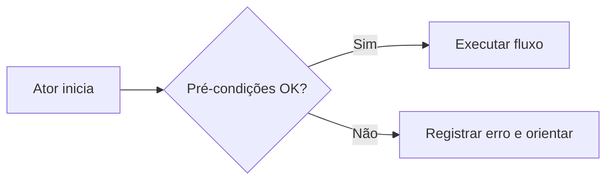

# Modelo UC-XXX — Nome do caso de uso

> Copie este arquivo e substitua os campos entre colchetes. **Não** marque aprovado sem evidência.

| Metadado | Valor |
|---|---|
| ID | UC-XXX |
| Versão | 0.1 |
| Estado | PROPOSTO / DECIDIDO / IMPLEMENTADO / TESTADO |
| Ator principal | [papel] |
| Sistemas externos | [dependências ou nenhum] |
| Requisitos relacionados | RF-XXX |
| Testes de aceite | AT-XXX |

## Objetivo e valor

[O que o usuário deseja concluir, por que importa.]

## Disparador e pré-condições

**Disparador:** [evento].  
**Pré-condições:** [condições observáveis].  
**Permissões:** [perfil ou nenhuma].

## Fluxo principal

1. [Ação do ator.]
2. [Validação do sistema.]
3. [Mudança de estado ou dado.]
4. [Feedback observável.]

## Fluxos alternativos

**A1 — [condição]:** a partir do passo [n], [comportamento e retorno].

## Erros e recuperação

**E1 — [falha]:** [mensagem, persistência, retry, limitação, ação do usuário].

## Pós-condições e invariantes

- Sucesso: [resultado mensurável].
- Falha: [integridade preservada].
- Invariantes: [garantias que não podem ser quebradas].

## Dados e regras

| Campo/Regra | Tipo/unidade | Origem | Tratamento |
|---|---|---|---|
| [campo] | [tipo] | [fonte] | [validação] |

## Critérios de aceite

- **AT-XXX-01:** Dado [contexto], quando [ação], então [resultado].
- **AT-XXX-02:** Dado [erro], quando [ação], então [proteção e mensagem].

## Riscos, evidências e pendências

[Riscos, limites, testes executados com versão/ambiente/resultado, ou explicitamente 'não testado'.]

## Diagrama (opcional)

