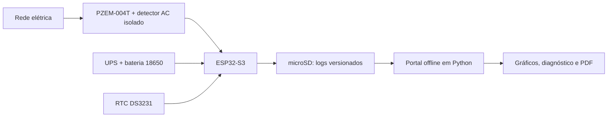

<p align="center">
  
</p>

<h1 align="center">Monitor Elétrico IoT</h1>
<p align="center"><strong>Registrador portátil de comportamento elétrico e análise de ocorrências</strong></p>
<p align="center">
  
  
  
  
</p>

> **Projeto em definição; portal MVP experimental disponível nesta branch, firmware não implementado.** O nome é provisório; a identidade visual foi aprovada em 2026-11-06. Este README documenta o escopo e as decisões, não uma instalação pronta.

## O problema

Equipamentos sofrem falhas intermitentes na alimentação elétrica, mas uma medição pontual pode parecer normal quando o técnico chega. O projeto pretende registrar a evolução da rede durante sete dias, preservar evidências e facilitar a investigação do comportamento elétrico.

**Objetivo:** obter histórico local confiável e auditável de grandezas disponibilizadas pelo sensor e de eventos detectados. O sistema não pretende substituir instrumento certificado de qualidade de energia.

## Como funciona



O PZEM fornece tensão e frequência e, quando o transformador de corrente for instalado corretamente, corrente, potência, fator de potência e energia. O ESP32 grava linhas de texto com blocos tipados e timestamps, mantendo a operação pela bateria durante falhas de alimentação, dentro da autonomia validada. Ao final, o cartão é importado no computador para análise.

## Principais capacidades planejadas

| Área | Planejado |
|---|---|
| Medição | Tensão, frequência e grandezas de carga condicionadas à instalação do CT |
| Continuidade | UPS com célula 18650 e RTC independente |
| Dados | microSD, linhas auditáveis delimitadas por `|`, tipos `000` e `999` |
| Ocorrências | Eventos de rede, falhas de sensor, reinicializações e lacunas |
| Portal | Python + FastAPI, importação local, filtros, gráficos e relatórios |
| Privacidade | Funcionamento offline, sem nuvem obrigatória |

**Limite essencial:** o PZEM-004T V3.0, na versão considerada, tem faixa especificada de 80–260 V AC e não assegura captura de picos transitórios ou afundamentos de milissegundos. Timeout do sensor **não equivale** a falta de rede: a detecção deve ser independente e isolada.

## Estado e próximos marcos

| Etapa | Situação |
|---|---|
| Definição de objetivo e componentes-base | Decidida conceitualmente |
| Especificação de protocolo e portal | Portal v0.3 especificado; protocolo pendente de congelamento |
| Seleção exata de UPS, alimentação, gabinete e isolamento | Pendente |
| Protótipo e validação elétrica | Não iniciado |
| Firmware | Não iniciado |
| Portal web e relatórios | MVP 0.1.2 na branch de desenvolvimento, validação manual pendente |
| Capturas de tela e manual ilustrado | Dependentes de software real |

## Experimentar o portal técnico (MVP experimental)

**Python 3.13.x obrigatório**, definido em [`.python-version`](.python-version) e [`pyproject.toml`](pyproject.toml).

No Windows, após clonar a branch `feature/portal-tecnico-mvp`, execute `& .\\Start-Portal.ps1`; no Linux, `bash start-portal.sh`. Abra `http://127.0.0.1:8080`. Os scripts preparam a instalação local e iniciam o serviço; a primeira instalação de dependências requer acesso ao índice de pacotes.

O painel oferece temas **Claro, Escuro e Sistema**, com preferência persistente. É **exclusivamente técnico**. As versões cliente e técnico existem apenas como **modelos PDF exportáveis**. Há três cenários sintéticos carregados sem hardware para explorar gráficos, eventos, filtros e auditoria.

- [Manual de execução do MVP](portal/README.md)
- [Temas visuais e acessibilidade](docs/technical/portal/06-temas-e-acessibilidade.md)
- [Roteiro de testes de usabilidade](docs/validacao/ROTEIRO_USABILIDADE_PORTAL_V011.md)
- [PR #1 (revisão e testes)](https://github.com/ChristopherNicolasSMM/Monitor-Eletrico-IOT/pull/1)

> A implementação está disponível para avaliação, mas **não há execução de testes automatizados confirmada**, nem validação elétrica ou metrológica.

## Navegação

### Para utilizar o equipamento

- [Introdução e objetivo operacional](docs/manual/01-introducao.md)
- [Primeiros passos e limites de segurança](docs/manual/02-primeiros-passos.md)
- [Funcionalidades previstas](docs/manual/03-funcionalidades.md)
- [Perguntas frequentes](docs/manual/04-perguntas-frequentes.md)

### Para desenvolver ou revisar

- [Índice técnico](docs/technical/README.md)
- [Visão geral e diagrama de arquitetura](docs/technical/01-visao-geral.md)
- [Requisitos e limites](docs/REQUISITOS.md)
- [Hardware e lista de materiais](docs/HARDWARE.md)
- [Protocolo de logs](docs/PROTOCOLO_LOG.md)
- [Portal de análise: arquitetura, três motores e duas visões](docs/technical/portal/README.md)
- [Portal: resumo e decisões](docs/PORTAL.md)
- [Decisões arquiteturais e pendências](docs/DECISOES.md)
- [Skill reutilizável de documentação](.github/skills/documentacao-profissional/SKILL.md)
- [Padrão editorial](docs/PADRAO_DOCUMENTACAO.md)
- [Caso de uso: importação e validação](docs/technical/05-casos-de-uso.md)
- [Identidade visual aprovada e nome provisório](docs/IDENTIDADE_VISUAL.md)

### Planejamento

- [Backlog e critérios de avanço](BACKLOG.md)

## Protocolo de registros

Cada entrada é uma linha completa, com envelope versionado, sequenciamento, carimbo temporal e verificação de integridade. Exemplo esquemático:

```text
|100|1|MEI-001|SESSION-001|3|2026-11-06T17:48:02.000Z|1000|v_rms=107.21;freq_hz=59.9;ac_state=present|PENDING|
```

O campo `PENDING` é apenas ilustração; a implementação deverá calcular a verificação real. [Consulte o protocolo](docs/PROTOCOLO_LOG.md) para tipos de blocos, incluindo `000` (abertura) e `999` (encerramento formal).

## Instalação e execução

**Existe um MVP experimental do portal nesta branch, ainda sujeito a testes manuais e automatizados.** O firmware de aquisição e a validação de hardware não foram realizados.

O portal futuro deve operar em Windows e Linux, sem conexão com a internet, podendo ser distribuído como aplicativo portátil.

## Segurança e uso responsável

A medição em 127/220 V exige proteção, isolamento, projeto de gabinete e validação por profissional habilitado. O dispositivo **não deve ser instalado em clientes** antes dos ensaios de alimentação, isolamento, detecção de interrupção e calibração. Não conectar diretamente terminais da rede a GPIOs ou USB de desenvolvimento.

Os relatórios deverão separar dados observados, cálculos, hipóteses e limitações. Não atribuir automaticamente a origem das perturbações à concessionária.

## Autoria

Concepção: Christopher Nicolas Santa Maria Mauricio. Política de licença ainda não definida; não pressupor licença open source pela visibilidade do repositório.
