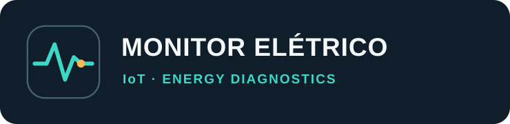

# Identidade visual aprovada

**Aprovação:** 2026-11-06.  
**Estado:** símbolo, estilo e paleta aprovados; **nome definitivo ainda em definição**.  
**Nome exibido temporariamente:** Monitor Elétrico IoT.

## Conceito

Identidade de instrumentação: ícone escuro de cantos arredondados, forma de onda/registro verde-água e ponto âmbar de ocorrência. O estilo deve comunicar tecnologia, confiabilidade, rastreabilidade e análise, sem sugerir que o instrumento possui certificação não obtida.

## Paleta

| Função | Cor | Hex |
|---|---|---|
| Fundo grafite | Grafite | `#101E2C` |
| Azul técnico | Azul-petróleo | `#1C3445` |
| Traçado/telemetria | Verde-água | `#3DD8C5` |
| Ocorrências/alertas | Âmbar | `#F7B955` |
| Texto principal escuro | Branco frio | `#F4F8FB` |
| Texto secundário | Cinza azulado | `#B7C9D4` |

## Ativos

- [Assinatura SVG](../assets/brand/logo.svg) para README e capa de portal/relatório, com **nome provisório**.
- [Símbolo SVG](../assets/brand/mark.svg) para favicon, etiqueta e UI, independente do nome.

A arte implementa o conceito gráfico já aprovado. A geometria, tipografia e aplicações poderão ser refinadas tecnicamente sem alterar a linguagem visual escolhida; **não alterar a paleta ou redesenhar o conceito sem nova decisão**.

## Aplicações

- README: assinatura visual centralizada, sem exagero de badges ou texto repetido.
- Portal: símbolo no menu, paleta funcional e acessível; âmbar reservado a alertas e eventos.
- PDF: cabeçalho com assinatura, eventos com cores e legenda, gráficos legíveis em preto e branco.
- Gabinete: símbolo vetorial adaptável a impressão monocromática.

## Pendências deliberadas

Nome e verificação de disponibilidade, tipografia licenciada, variantes monocromáticas e favicon final. Assim que o nome for escolhido, atualizar a parte textual de `logo.svg`, preservando o símbolo aprovado, e revisar títulos/documentos.
