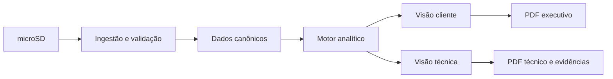

# Portal de análise offline — índice funcional v0.3

**Estado:** especificação funcional documentada; portal ainda não implementado. Atualizado em 2026-11-06.

O portal foi detalhado em **três subsistemas** e **dois níveis de apresentação**. O conteúdo técnico canônico está concentrado em:

1. [Importação e validação de arquivos](technical/portal/01-importacao-validacao.md)
2. [Motor de análise elétrica](technical/portal/02-motor-analise.md)
3. [Interface e relatórios](technical/portal/03-interface-relatorios.md)
4. [Casos de uso UC-002 a UC-007](technical/portal/04-casos-de-uso.md)
5. [Testes de aceite e gates](technical/portal/05-testes-aceite.md)
6. [Índice e regras transversais](technical/portal/README.md)

## Decisões

- Backend em **Python + FastAPI**; cálculo em Pandas/NumPy; gráficos Plotly; frontend responsivo HTML/CSS/JavaScript.
- Processamento offline e preservação dos arquivos originais com SHA-256.
- Análises versionadas por hash, parâmetros, versão do algoritmo e referências de registros.
- Modo **Cliente** e modo **Técnico**, com mesma fonte matemática e níveis distintos de detalhamento.
- Relatório executivo e relatório técnico exportados em PDF, além de CSV/JSON com metadados.
- Erros de sensor, lacunas de medição e falhas do RTC não podem ser convertidos em leituras válidas ou eventos comprovados.
- Empacotamento portátil Windows/Linux planejado, ainda não realizado.

## Fluxo principal

## Documentos relacionados

[Protocolo de logs](PROTOCOLO_LOG.md) · [Requisitos](REQUISITOS.md) · [Decisões](DECISOES.md) · [Backlog](../BACKLOG.md).

**Nota:** qualquer referência a telas, endpoints, entidades ou PDFs neste documento representa intenção de projeto até que haja código e validação.
