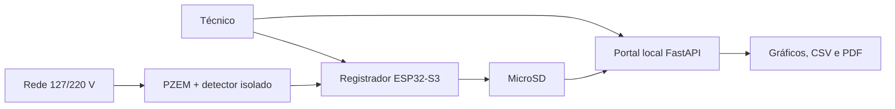
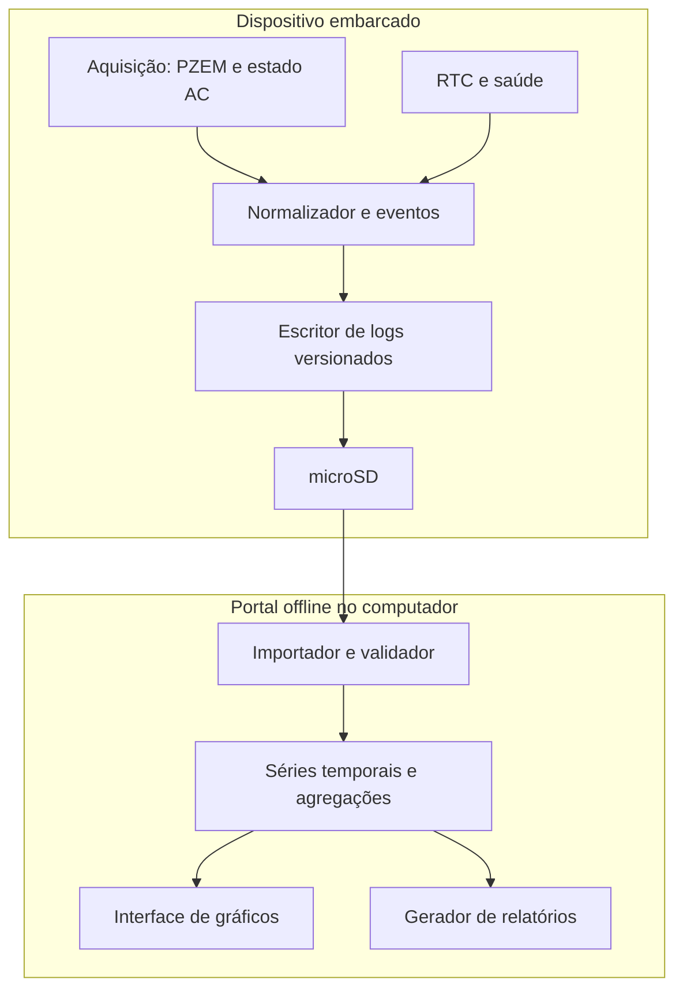

# 01 — Visão geral técnica

**Estado:** proposta de arquitetura, não implementação.

## Contexto

Um registrador embarcado coleta grandezas elétricas disponíveis no PZEM-004T, utiliza detector AC independente para identificar interrupção, RTC DS3231 para datas e UPS 18650 para continuidade de gravação, com arquivos microSD importados posteriormente por portal Python offline.

## Diagrama de contexto

## Contêineres lógicos

## Contratos e restrições

A fonte principal é a rede, mas a lógica de interrupção não deve depender de timeout do PZEM. Leituras abaixo de 80 V ou acima de 260 V não são consideradas medidas confiáveis pelo módulo na variante prevista. Corrente e potência dependem do CT. O parser aceita apenas versões declaradas e preserva o arquivo original.

## Desdobramentos

Consultar [hardware](../HARDWARE.md), [protocolo](../PROTOCOLO_LOG.md) e [portal](../PORTAL.md).
