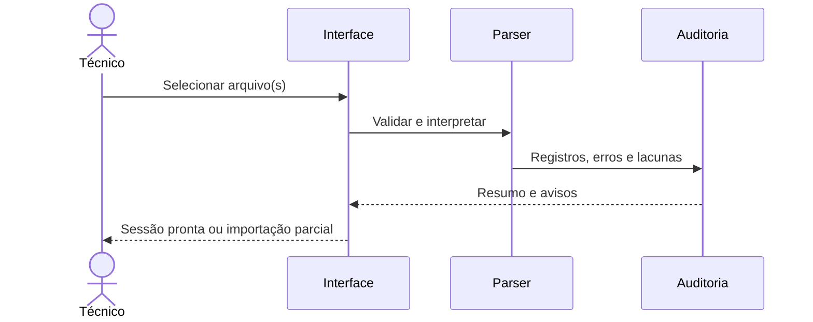

# UC-001 — Importar e validar sessão de medição

| Campo | Definição |
|---|---|
| Versão | 0.1 |
| Estado | PROPOSTO; nenhum código implementado |
| Ator principal | Técnico responsável pela análise |
| Sistema | Portal offline no computador |
| Requisitos relacionados | RF02, RF04, RF08, RF09, RF10 |
| Aceite | AT-001-01 a AT-001-05 |

## Objetivo

Transformar uma sessão de arquivos de texto do microSD em um conjunto de dados rastreável, pronto para visualização, sem modificar nem apagar o original.

## Disparador e pré-condições

**Disparador:** técnico solicita importar arquivo/pasta.  
**Pré-condições:** portal local em execução; arquivo disponível; acesso autorizado ao arquivo.  
**Permissões:** acesso local ao aplicativo, conforme política de segurança do produto.

## Fluxo principal

1. Técnico seleciona um arquivo ou conjunto de arquivos de uma sessão.
2. Portal valida extensão, formato, limite de tamanho e versão do protocolo.
3. Parser interpreta envelope, contador sequencial, tipo de bloco, timestamp e CRC.
4. Sistema agrupa os registros por dispositivo/sessão e identifica falhas, lacunas e duplicações.
5. Sistema mantém cópia imutável ou referência verificável do original e apresenta resumo da integridade.
6. Técnico escolhe abrir a análise e os gráficos de dados válidos.

## Alternativas

**A1 — múltiplas sessões:** o portal separa identificadores e permite análise por sessão, sem misturar sequências.  
**A2 — somente leituras sem CT:** o portal exibe tensão/frequência e sinaliza corrente e potência como indisponíveis.

## Erros e recuperação

**E1 — linha truncada:** marcar número/offset da linha, preservar arquivo e seguir nos registros recuperáveis.  
**E2 — CRC divergente:** sinalizar registro inválido e excluir de agregados padrão, mantendo consulta ao original.  
**E3 — versão não suportada:** informar versão identificada; não tentar adivinhar campo desconhecido.  
**E4 — arquivo muito grande:** interromper importação com indicação de limite; evitar carregar tudo na memória.  
**E5 — sessão sem `999`:** destacar encerramento não formal sem atribuir causa.

## Pós-condições

- Sucesso: conjunto de dados importado, auditável e sem adulterar origem.
- Falha: importação abortada ou parcial identificada; original íntegro.
- Invariantes: dados `NA` não viram zero; timeout PZEM não se converte em falta de rede; timestamps de baixa confiança são indicados.

## Critérios de aceite

- **AT-001-01:** um arquivo válido produz o mesmo número de registros válidos com IDs preservados.
- **AT-001-02:** linha truncada sinaliza posição e não impede importação de linhas subsequentes íntegres.
- **AT-001-03:** CRC inválido é separado das medições confiáveis e aparece na auditoria.
- **AT-001-04:** arquivo com abertura `000` sem encerramento `999` identifica sessão não formalmente encerrada.
- **AT-001-05:** execução, importação e análises básicas funcionam sem internet.

## Segurança e limites

Não executar conteúdo do arquivo, bloquear caminhos relativos e traversal, limitar uploads e preservar rastreabilidade. O protocolo v1 e o algoritmo CRC ainda precisam ser congelados; portanto este caso de uso não está testado.

## Sequência

