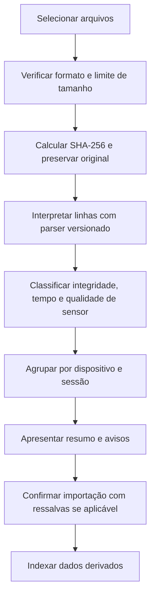

# 01 — Importação e validação de arquivos

**Versão:** 0.3. **Estado:** especificação proposta, ainda sem implementação.

## Objetivo

Importar logs de um cartão microSD, verificar a consistência dos registros e gerar um conjunto canônico de dados sem alterar os arquivos originais. O módulo implementará os casos UC-001 e UC-002.

## Entrada

- Um ou vários arquivos `.log` UTF-8 escolhidos explicitamente pelo usuário.
- Uma pasta com arquivos selecionados, quando o navegador permitir.
- No futuro, pacote ZIP, sujeito à validação específica.
- Protocolo de uma linha por registro: `|tipo|versão|dispositivo|sessão|sequência|data_hora|uptime|payload|crc32|` conforme [PROTOCOLO_LOG.md](../../PROTOCOLO_LOG.md).

O método exato de CRC e escape ainda precisa ser definido e testado conjuntamente com o firmware.

## Fluxo



## Validações obrigatórias

| ID | Validação | Resultado |
|---|---|---|
| IMP-01 | Arquivo UTF-8, extensão e tamanho | Aceito ou rejeitado com mensagem |
| IMP-02 | Envelope e delimitadores | Linha íntegra ou malformada |
| IMP-03 | Versão do protocolo | Interpretar apenas esquema suportado |
| IMP-04 | CRC por linha | Divergência exclui linha dos indicadores e preserva origem |
| IMP-05 | Sequência monotônica por sessão | Saltos, duplicatas e reversões indicados |
| IMP-06 | Blocos 000 e 999 | Abertura e encerramento formal reconhecidos |
| IMP-07 | RTC, uptime, timestamp UTC | Saltos e horários incertos sinalizados |
| IMP-08 | Sensor PZEM, idade da amostra | Ausência, dado obsoleto e erro diferenciados |
| IMP-09 | Detector AC independente | Falta confirmada distinta de falha serial |
| IMP-10 | Campos extras e NA | Preservados sem atribuir valor zero |
| IMP-11 | SHA-256 repetido | Evitar duplicação acidental de medições |

A validade da linha e a qualidade da medida são avaliações distintas. Um CRC correto não assegura que o RTC estava certo ou que a grandeza medida estava dentro da faixa especificada.

## Classificação

- **Íntegro:** registros interpretáveis e sem ressalvas materiais.
- **Parcial:** há registros válidos, mas também lacunas, encerramento ausente, hora incerta ou problemas de sensor.
- **Não interpretável:** dados incompatíveis ou registros insuficientes para análise confiável.

A interface mostrará total de registros, válidos, inválidos, período, sessões, qualidade temporal e extensão das lacunas, com acesso à linha original correspondente.

## Modelo de dados proposto

```text
ImportBatch(id, created_at, status, files)
SourceFile(id, sha256, original_name, bytes, path)
Campaign(id, device_id, location_label, nominal_voltage, period)
Session(id, boot_time, close_time, quality)
Record(id, source_file_id, line_number, seq, block_type, timestamp, payload, flags)
DataIssue(id, record_id, issue_type, severity, explanation)
```

São entidades de planejamento, ainda não criadas em banco. Original preservado e dados derivados armazenados separadamente. Dados pessoais do cliente ficam em metadados específicos.

## Confiabilidade operacional

Importação com progresso e cancelamento controlado, leitura por partes para arquivos grandes, limite configurável de tamanho, identificação de duplicatas e recuperação de linhas posteriores a uma falha. O portal executa localmente; somente arquivos selecionados pelo usuário entram no processo. Nenhuma entrada importada deve ser tratada como comando executável. Mensagens de erro não devem alterar o original.

## Saída para o motor analítico

Dataset canônico com valores/unidades, identificadores, referência de arquivo e linha, máscaras de qualidade por campo, idade do dado, timestamp com grau de confiabilidade e eventos detectados. O motor decide quais medidas são elegíveis para cada cálculo, registrando os critérios aplicados.

## Critérios de aceite

- AT-002-01: linha truncada não impede recuperar linhas posteriores íntegras.
- AT-002-02: discrepâncias de integridade são listadas e localizáveis.
- AT-002-03: arquivo repetido não duplica observações.
- AT-002-04: sessão sem 999 é classificada como encerramento não formal, sem inferir a causa.
- AT-002-05: sistema distingue timeout PZEM de interrupção confirmada.
