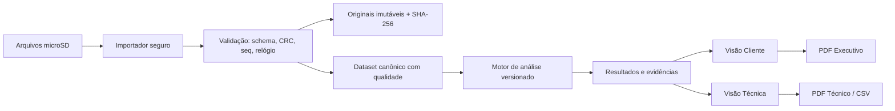

# Portal de análise elétrica — especificação v0.3

**Estado:** PROPOSTO / DECIDIDO em nível funcional, **não implementado**. Atualizado em 2026-11-06.

## Objetivo

Transformar os registros de texto versionados do dispositivo ESP32-S3/PZEM-004T em evidências de comportamento elétrico e relatórios interpretáveis. O portal funciona offline em computador, com uma única base analítica e dois modos de apresentação: **Cliente** e **Técnico**.

## Organização em três subsistemas

1. [Importação e validação](01-importacao-validacao.md): ingestão, proveniência, integridade, sessões e qualidade temporal.
2. [Motor de análise elétrica](02-motor-analise.md): estatísticas, eventos, cobertura, relações temporais e hipóteses.
3. [Interface e relatórios](03-interface-relatorios.md): navegação, perfis, visualizações, relatórios e exportações.

[Casos de uso do portal](04-casos-de-uso.md) · [Aceite e testes planejados](05-testes-aceite.md) · [Protocolo de origem](../../PROTOCOLO_LOG.md).

## Arquitetura lógica proposta

**Stack escolhida para planejamento:** Python + FastAPI, Pandas/NumPy e Plotly.js; HTML/CSS/JS responsivo. Distribuição portátil Windows/Linux é objetivo futuro, ainda não implementado. SQLite pode servir de índice local, sem substituir logs originais.

## Regras transversais

- Um resultado calculado deve ter referência à sessão, janela temporal, versão do algoritmo, configuração de limiares e origem dos registros.
- **Fato observado**, **indicador derivado**, **hipótese** e **conclusão externa validada** são conceitos distintos.
- Nenhum resultado interpreta timeout PZEM como interrupção de rede sem detector AC independente.
- Nunca transformar `NA`, leitura inválida ou ausência de CT em zero.
- Amostras com tempo inválido devem ser segregadas; não inventar ordem temporal por timestamp; sequência e uptime podem auxiliar investigação, com incerteza explícita.
- PDF de cliente e técnico usa o mesmo motor, mas seleciona o conteúdo por perfil.
- Nenhum relatório pode afirmar conformidade regulatória sem método, critérios, instrumento e calibração adequados.
- Portal em loopback `127.0.0.1` por padrão. Sem autenticação, não expor a outras interfaces; proteger origem, CSRF, caminhos e tamanho de importação.

## Glossário

- **Sessão:** unidade de boot aberta pelo bloco `000`; termina formalmente apenas com `999`.
- **Campanha:** período de observação de um local; pode ter múltiplas sessões por reinicializações.
- **Amostra:** registro 100, com atualização e qualidade próprias.
- **Evento:** transição detectada com início/fim e confiabilidade.
- **Cobertura:** tempo para o qual existem dados válidos, distinto do intervalo entre primeira e última linha.
- **Evidência:** registros de origem, regra/algoritmo, versão e trecho de dados que sustentam uma afirmação.
